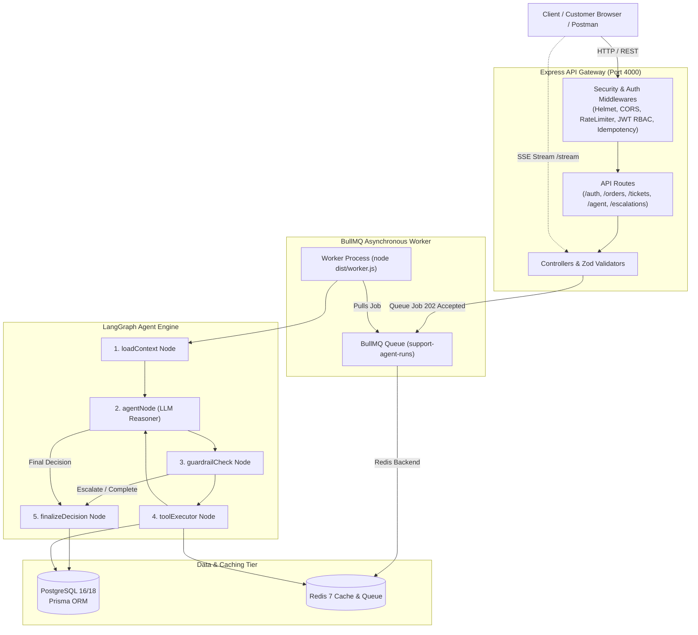
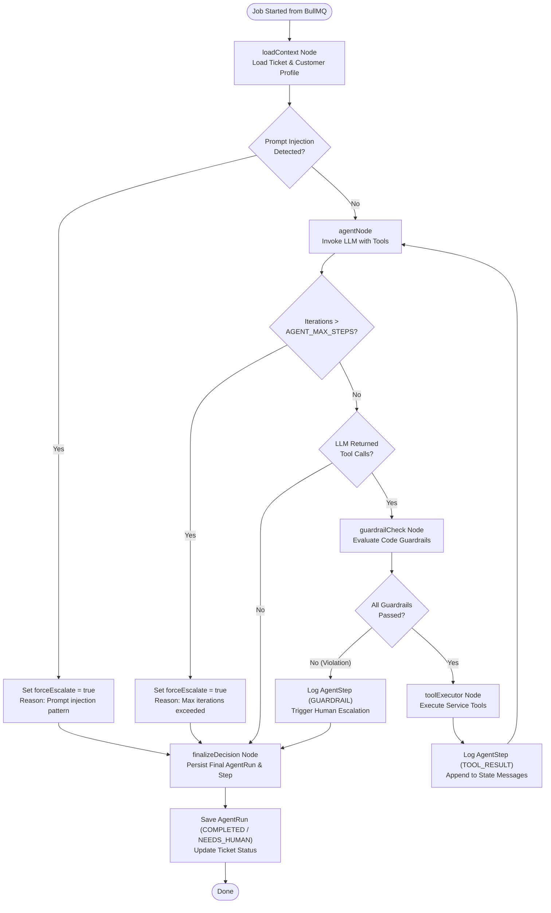
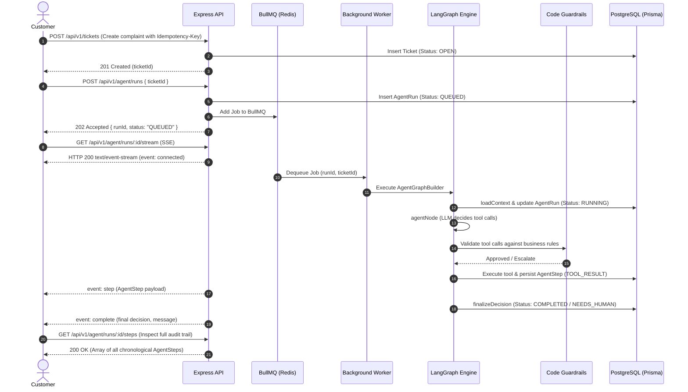
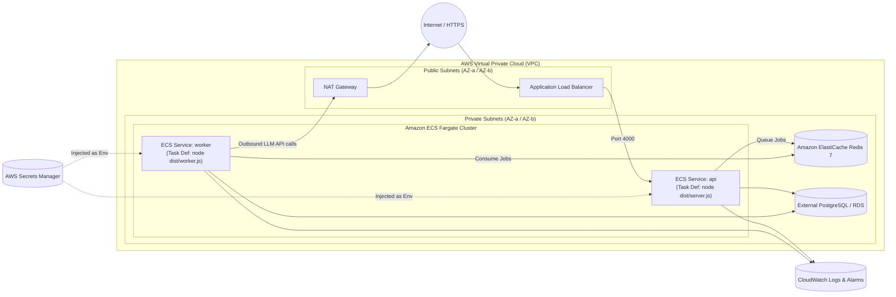

# Autonomous Agentic Support Service - System Architecture

This document provides a comprehensive architectural breakdown of the **Autonomous Agentic Support Service**, an enterprise autonomous customer support service featuring LangGraph-powered state machines, tool-calling agents, deterministic business guardrails in code, BullMQ asynchronous processing, and an AWS ECS deployment topology.

---

## 1. High-Level System Architecture

The service follows a strict **Layered Architecture**:
- **Presentation Layer**: Express 4 routes, input validation middleware (Zod), JWT authentication & RBAC, idempotency headers, Helmet security, and rate limiting.
- **Controller Layer**: Decoupled HTTP handlers extracting parameters and returning uniform JSON responses.
- **Service Layer**: Business workflows, BullMQ queue dispatch, and SSE live step broadcasting.
- **Agent Orchestration**: LangGraph state machine with 5 core nodes, versioned system prompts, and tool calling.
- **Guardrails Engine**: Enforces deterministic financial thresholds, cross-user ownership verification, and security boundaries in TypeScript before and during tool calls.
- **Repository & Data Access**: Prisma ORM with connection pooling, transactional consistency, and Redis caching.

---

## 2. LangGraph Agent State Machine

The autonomous support agent operates on a cyclical state machine built with **LangGraph**:
1. **`loadContext`**: Loads customer and complaint ticket from PostgreSQL. Executes heuristic prompt-injection guardrails.
2. **`agentNode`**: Invokes the LLM (Gemini 2.0 Flash or OpenAI) with 9 structured service tool definitions. Enforces max iterations (`AGENT_MAX_STEPS`).
3. **`guardrailCheck`**: Deterministic TypeScript code inspecting every planned tool call before execution:
   - Validates that the customer owns the requested order (`order.userId === ticket.userId`).
   - Validates that refund amounts do not exceed the order total.
   - Blocks refunds exceeding `HIGH_VALUE_THRESHOLD` (₹20,000) and redirects to human escalation.
   - Enforces prerequisites (`checkReturnEligibility` before `initiateRefund`; `checkWarrantyStatus` before `createReplacementOrder`).
   - Limits refunds to a maximum of 1 per run.
4. **`toolExecutor`**: Executes authorized tools, records latency and parameters into `AgentStep` audit logs, and appends `ToolMessage` results back to LLM context.
5. **`finalizeDecision`**: Validates structured output schema (`AgentDecisionOutput`), records final audit step, updates `AgentRun.status`, and creates human review in `Escalation` table if escalated.

---

## 3. End-to-End Request & Event Data Flow

---

## 4. AWS Cloud Production Architecture

The application is deployed on AWS following secure, cost-optimized best practices:
- **Networking**: VPC across 2 Availability Zones (`ap-south-1`), 2 public subnets (ALB & NAT), 2 private subnets (ECS & ElastiCache).
- **Application Load Balancer (ALB)**: Terminating SSL/TLS with ACM certificate, routing HTTP to HTTPS, forward to ECS task target group with `/api/v1/health` health checks.
- **ECS Fargate Services**:
  - `api` service: Autoscaling from 1 to 4 tasks based on 60% CPU utilization.
  - `worker` service: Autoscaling from 1 to 3 tasks running `node dist/worker.js`.
- **Database & Secrets**: Managed via AWS Secrets Manager with zero secrets in source control or Terraform state files.
- **Monitoring**: CloudWatch log streams with 14-day retention, 5xx error alarms, high CPU alarms, and SNS email notifications.

---

## 5. Summary of Decision Policies & Guardrails

| Guardrail Rule | Condition / Threshold | Action Taken |
|---|---|---|
| **Prompt Injection** | Regex matches malicious override patterns | Blocks run, logs GUARDRAIL step, forces `escalateToHuman` |
| **Cross-User Ownership** | `order.userId !== ticket.userId` | Blocks tool, logs security violation, forces `escalateToHuman` |
| **Max Refund Limit** | `run.refundCount >= 1` | Blocks subsequent refunds in the same run |
| **Refund Amount Cap** | `refund.amount > order.totalAmount` | Blocks refund, notifies LLM of invalid amount |
| **High Value Transaction** | `refund.amount > HIGH_VALUE_THRESHOLD` (₹20,000) | Blocks automatic refund, forces `escalateToHuman` |
| **Prerequisite Check: Refund** | `initiateRefund` called without prior `checkReturnEligibility` | Blocks refund with prerequisite error |
| **Prerequisite Check: Replacement** | `createReplacementOrder` without `checkWarrantyStatus` or `checkReturnEligibility` | Blocks replacement with prerequisite error |
| **Max Step Iterations** | `iterations > AGENT_MAX_STEPS` (8) | Halts cycle, marks run `NEEDS_HUMAN`, triggers human queue |
